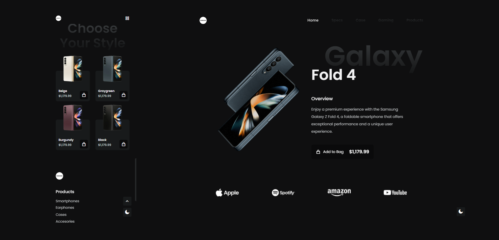

# Responsive Landing Page - Galaxy Fold 4

## Descripción

Bienvenido a la página de aterrizaje (Landing Page) responsiva para el Galaxy Fold 4, un producto ficticio e innovador que expande los límites de la tecnología móvil. Esta página fue creada combinando HTML, CSS y JavaScript, asegurando una experiencia de usuario fluida e interactiva.

## Estructura del Proyecto

El proyecto está organizado de la siguiente manera:

*   **`index.html`**: El archivo HTML principal que contiene la estructura de la página.
*   **`assets/`**: Carpeta que contiene los recursos estáticos.
    *   **`css/`**: Contiene los archivos de estilos (CSS).
    *   **`js/`**: Contiene los scripts de JavaScript.
        *   `main.js`: Lógica principal de la aplicación.
        *   `scrollreveal.js`: Librería para animaciones al hacer scroll.
    *   **`img/`**: Contiene las imágenes utilizadas en el sitio.

## Tecnologías Utilizadas

- **HTML:** Proporciona la estructura y el diseño de la página.
- **CSS:** Estiliza la página, haciéndola visualmente atractiva y consistente.
- **JavaScript:** Añade interactividad y comportamiento dinámico a la página.

## Configuración y Uso

Para ver el proyecto en funcionamiento:

1.  Clona este repositorio o descarga los archivos.
2.  Abre el archivo `index.html` en tu navegador web preferido.

### Funcionalidades

*   **Navegación Responsiva:** El menú se adapta a dispositivos móviles y de escritorio.
*   **Cambio de Tema:** Puedes alternar entre modo claro y oscuro usando el botón flotante. La preferencia se guarda para futuras visitas.
*   **Scroll Activo:** El menú de navegación resalta automáticamente la sección actual que estás viendo.
*   **Botón Volver Arriba:** Aparece un botón para volver al inicio de la página cuando bajas haciendo scroll.

## Live

https://guidopellegrini.github.io/landing-page-galaxy-fold/

## Vista Previa

